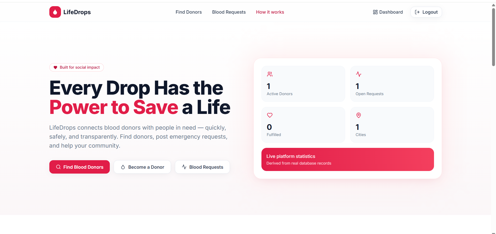
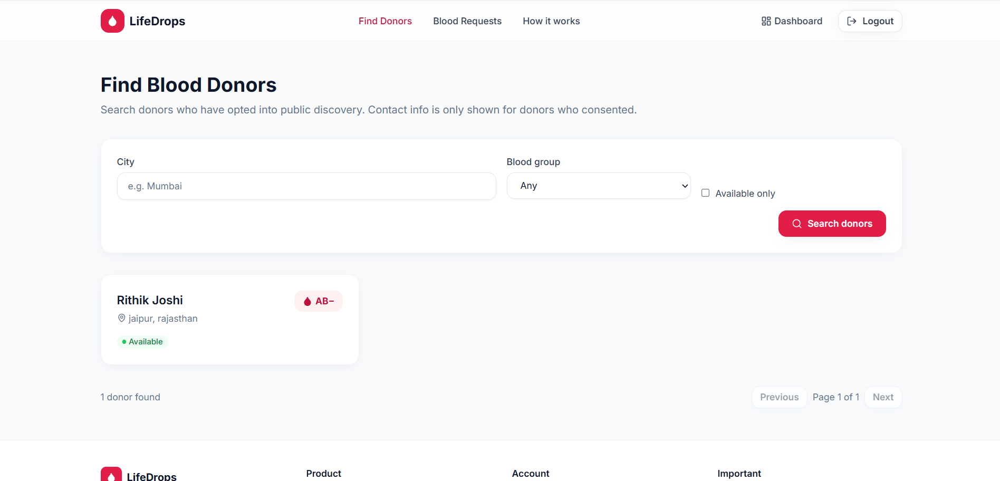
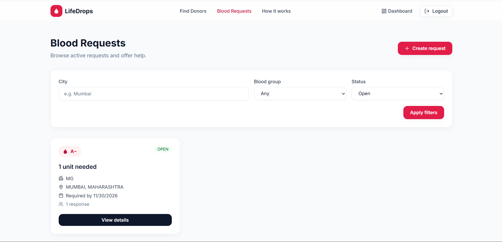
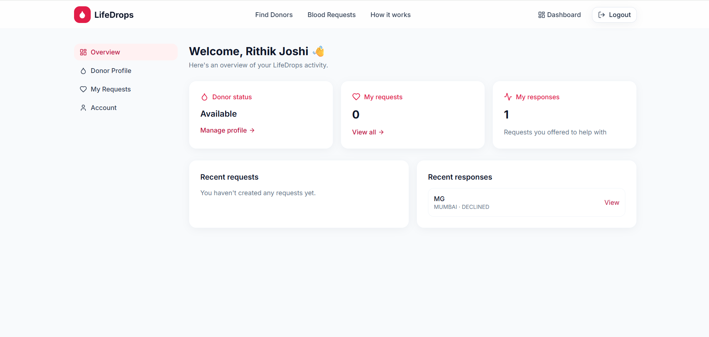

<div align="center">

# 🩸 LifeDrops

### Blood Donor Discovery & Emergency Request Management

A full-stack web application that helps people discover volunteer blood donors and manage blood requests through a shared, database-backed platform.

**[🌐 Live Demo](https://life-drops.vercel.app/)** · **[💻 Source Code](https://github.com/Rithik-joshi/LifeDrops)**

</div>

> [!IMPORTANT]
> **Portfolio demonstration only.** LifeDrops is not a hospital, blood bank, or verified emergency-response service. Donor availability and medical compatibility are not guaranteed. For urgent medical needs, contact a hospital or local emergency services.

## 📸 Screenshots

### Home Page


### Find Donors


### Blood Requests


### Dashboard


## ✨ Key Features

- **Authentication:** Register, log in, and access protected pages with JWT-based authentication.
- **Donor profiles:** Create and update donor details, control availability, and choose whether a profile appears in donor search.
- **Find donors:** Search discoverable donor profiles using city and blood-group filters.
- **Blood requests:** Create, manage, and track requests for blood donations.
- **Donor responses:** Express interest in requests and manage response status.
- **Dashboard:** View personal activity, requests, and responses.
- **Admin capabilities:** Backend-protected administrative routes for platform management.
- **Responsive interface:** Built for desktop and mobile screens.

## 🛠️ Tech Stack

| Layer | Technologies |
| --- | --- |
| Frontend | React, Vite, Tailwind CSS, React Router, Axios, Lucide React |
| Backend | Node.js, Express.js, JWT, bcryptjs, Zod |
| Database | PostgreSQL (Neon), Prisma ORM |
| Deployment | Vercel (frontend), Render (backend), Neon (database) |

## 🏗️ Architecture

```text
User's browser
      |
      v
React frontend (Vercel)
      |
      v
Express REST API (Render)
      |
      v
Prisma ORM
      |
      v
PostgreSQL database (Neon)
```

## 📂 Project Structure

```text
LifeDrops/
├── client/                 # React + Vite frontend
│   └── src/
├── server/                 # Express API
│   ├── prisma/             # Prisma schema and migrations
│   └── src/                # Routes, controllers, middleware
├── docs/
│   └── screenshots/        # README screenshots (add these)
└── README.md
```

## ⚙️ Run Locally

**Prerequisites:** Node.js and a PostgreSQL database (for example, Neon).

1. Clone the repository:

   ```bash
   git clone https://github.com/Rithik-joshi/LifeDrops.git
   cd LifeDrops
   ```

2. Install backend dependencies:

   ```bash
   cd server
   npm install
   ```

3. Create `server/.env` using `server/.env.example` as a reference. Configure at least the database URL, JWT secret, and local frontend origin:

   ```dotenv
   DATABASE_URL=your_postgresql_connection_url
   JWT_SECRET=your_long_random_secret
   CLIENT_ORIGIN=http://localhost:5173
   PORT=5000
   ```

   **Never commit real `.env` files or credentials.**

4. Apply existing database migrations, generate Prisma Client, and start the backend:

   ```bash
   npx prisma migrate deploy
   npx prisma generate
   npm run dev
   ```

5. In a **new terminal**, start the frontend:

   ```bash
   cd client
   npm install
   npm run dev
   ```

   If your frontend uses `VITE_API_URL`, set it to `http://localhost:5000/api` in `client/.env` before starting Vite.

6. Open `http://localhost:5173` in your browser.

## 🚀 Deployment

- **Database:** Host PostgreSQL on Neon and configure `DATABASE_URL` on Render.
- **Backend:** Deploy the `server` directory as a Render Web Service. Generate Prisma Client during build and run the Express start script.
- **Frontend:** Deploy the `client` directory to Vercel using the Vite preset.
- **Frontend environment:** Set `VITE_API_URL` to your Render API URL ending in `/api`.
- **Backend environment:** Set `CLIENT_ORIGIN` to your exact Vercel site origin (without a trailing slash).

**Live site:** https://life-drops.vercel.app/

## 🔐 Privacy & Limitations

- Donor profiles appear in discovery only when the donor has enabled discoverability.
- This is a portfolio project; donor identity, medical eligibility, and blood availability are not independently verified.
- No built-in email verification or password recovery flow is documented.
- Avoid entering real medical or sensitive personal information during testing.
- Render free-tier instances may take extra time to respond after inactivity.

## 👨‍💻 Project Purpose

LifeDrops was built as a social-impact portfolio project to demonstrate full-stack development, REST API integration, authentication, relational data modeling, and cloud deployment.

## 👨‍💻 Developer

**Rithik Joshi** — Software Developer

Passionate about building practical web applications that solve real-world problems.

**Connect with me:**

- 💼 [LinkedIn](https://www.linkedin.com/in/rithikjoshi27/)
- 💻 [GitHub](https://github.com/Rithik-joshi)
- 🌐 [Live Project](https://life-drops.vercel.app/)

---

## ⭐ Support This Project

If you found **LifeDrops** useful or interesting, consider giving this repository a ⭐ on GitHub.

Your support motivates me to build more meaningful projects!

**[⭐ Star LifeDrops on GitHub](https://github.com/Rithik-joshi/LifeDrops)**

---

<p align="center">
  Made with ❤️ by <a href="https://github.com/Rithik-joshi">Rithik Joshi</a>
</p>
